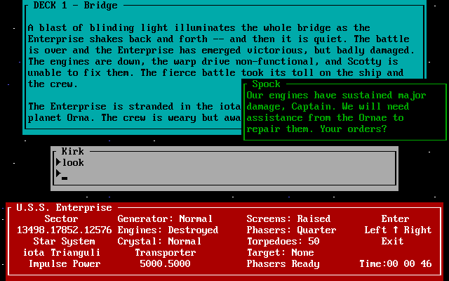
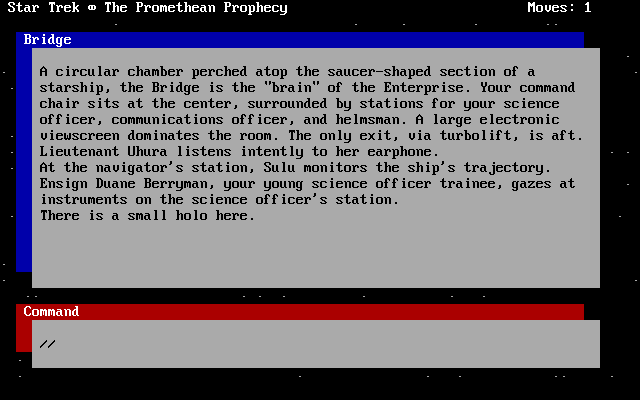
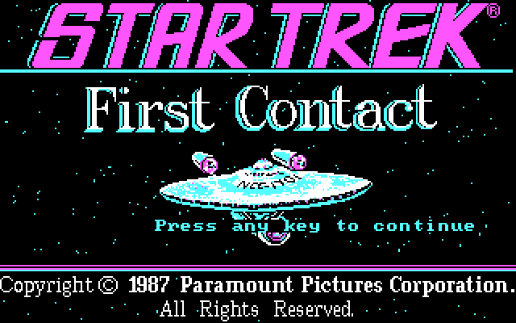

# Stardate

**Stardate** plays Simon & Schuster's *Star Trek* interactive fiction for the IBM PC, as it was back in the good old days. It's a C# DOS PC emulator built for these games alone, not to be a whole PC: you pick a game and it plays, at the speed it was meant to run, in the colors and characters it was originally drawn in.

<table>
<tr>
<td align="center" valign="top"><br><i>The Kobayashi Alternative</i></td>
<td align="center" valign="top"><br><i>The Promethean Prophecy</i></td>
<td align="center" valign="top"><br><i>First Contact</i></td>
</tr>
</table>

## Why

Stardate exists to preserve these games as they were: three of the "lost adventures of the starship Enterprise", from the years when a *Star Trek* game was something you read and typed.

| Short name | Game | Year |
|---|---|---|
| `stka` | *Star Trek: The Kobayashi Alternative* | 1985 |
| `stpp` | *Star Trek: The Promethean Prophecy* | 1986 |
| `stfc` | *Star Trek: First Contact* | 1987 |

All three are included, by permission of their copyright holders (see [NOTICE.md](NOTICE.md)).

## Playing

### From the source

With the [.NET 10 SDK](https://dotnet.microsoft.com/download):

```
dotnet run --project src/Stardate.Player -c Release -- stka
```

With no game named, a menu lists the three.

### In the game

- **The window:** F11 is full screen, F12 runs at full speed, and Pause pauses.
- **Saved states:** Ctrl+F5 saves the whole machine's state and Ctrl+F9 loads it back (`--resume` starts from it). The games' own saves work as they always did.
- **The font:** the text is drawn with the VGA's 8 by 16 font, as on the PCs these games were mostly played on. `--cga-font` draws it with the CGA's own 8 by 8, as on the PCs they were written for.
- `--help` lists the rest.

The games' folders are only read: what a game writes, its saves included, goes to a folder of its own, in a `Stardate` folder in the user's application data.

## How it works

Stardate's core began as a copy of [Confederation](https://github.com/jeffnyman/confederation)'s, which plays the *Wing Commander* games, cut down to what these games need and given what they need that it didn't have:

- **The processor** is Confederation's 386, checked against 1.76 million captured real-mode test instructions. The games were written for the 8088, which the 386 runs as it ran then.
- **DOS and the BIOS** are answered in C#, against the game's folder as drive C:. DOS loads `.COM` programs as well as `.EXE`s, which *The Promethean Prophecy*'s launcher needs.
- **The display** is IBM's Color Graphics Adapter: 16-color text, with its blinking and its cursor, drawn in the PC's own character set, and the CGA's graphics modes, in which *First Contact* draws its pictures. The video BIOS does what a CGA's did: scrolling, the cursor, writing characters in text and graphics.
- **The sound** is the PC's speaker: tones from the timer, and the clicks of a program toggling it directly.

Expanded memory, protected mode, the mouse, the joystick, the CD and the sound cards Confederation needed are gone. [ROADMAP.md](ROADMAP.md) lays out what's done and what's next.

[`tools/`](tools/README.md) has `stardate-driver`, which plays the games headless from scripts and looks inside them as they play, with routes that play *The Kobayashi Alternative* and *The Promethean Prophecy* to their winning endings. The walkthroughs in [`walkthroughs/`](walkthroughs) were checked with it.

## Author

<p align="center">
  Made with 🤍 by <a href="https://github.com/jeffnyman">Jeff Nyman</a>
</p>

<p align="center">
  
</p>

<p align="center">
  <a href="https://testerstories.com" target="_blank" >
    
  </a>
</p>
<p align="center">
  <a href="https://www.linkedin.com/in/jeffnyman/" target="_blank" >
    
  </a>
</p>

## Doxazein (δοξάζειν)

<p align="center">
  חֶסֶד וֶאֱמֶת אַל־יַעַזְבֻךָ קָשְׁרֵם עַל־גַּרְגְּרֹתֶיךָ כָּתְבֵם עַל־לוּחַ לִבֶּךָ
</p>

<p align="center">
"Let not mercy and truth forsake thee:<br>
bind them about thy neck;<br>
write them upon the table of thine heart."<br>
<em>Proverbs 3:3</em>
</p>

## License

**Stardate**, A Player for Simon & Schuster's *Star Trek* Interactive Fiction\
Copyright (C) 2026 [Jeff Nyman][owner]

[][GNU General Public License]

> This program is free software: you can redistribute it and/or modify
> it under the terms of the [GNU General Public License] as published by
> the Free Software Foundation, either version 3 of the License, or
> (at your option) any later version.
>
> This program is distributed in the hope that it will be useful,
> but WITHOUT ANY WARRANTY; without even the implied warranty of
> MERCHANTABILITY or FITNESS FOR A PARTICULAR PURPOSE. See the
> [GNU General Public License] for more details.

[owner]: https://github.com/jeffnyman
[GNU General Public License]: https://www.gnu.org/licenses/gpl-3.0.en.html

The emulator core is derived from [Confederation](https://github.com/jeffnyman/confederation), also by Jeff Nyman. Portions of it, and the PC's ROM font in `src/Stardate.Core/Fonts`, are derived from DOSBox, © the DOSBox Team, under the GNU General Public License, version 2 or later.

The *Star Trek* games in `games/` are not part of Stardate's own work and do not fall under this license. They are copyrighted works of their owners, included by permission, and may not be sold or charged for; see [NOTICE.md](NOTICE.md).
