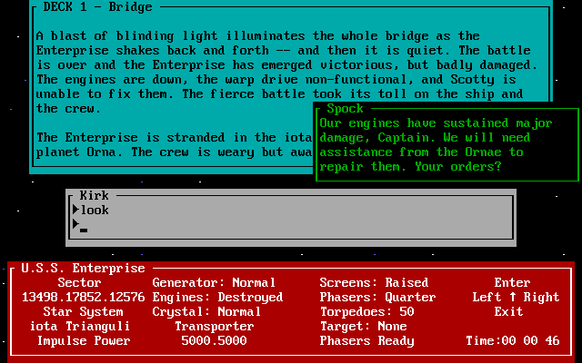
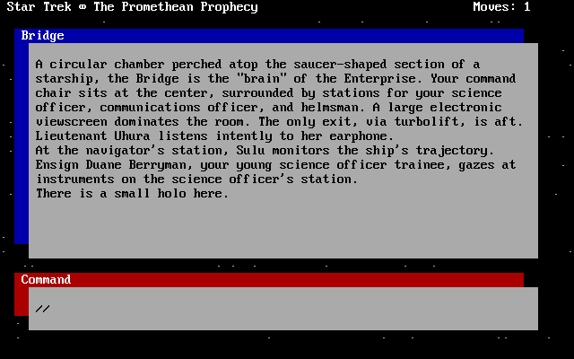
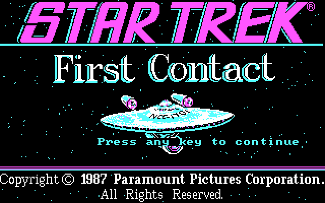

# Stardate

**Stardate** plays Simon & Schuster's *Star Trek* interactive fiction for the IBM PC, as it was.
It's a C# DOS PC emulator built for these games alone, not to be a whole PC: you pick a game and
it plays, at the speed it was meant to run, in the colors and characters it was drawn in.

<table>
<tr>
<td align="center" valign="top"><br><i>The Kobayashi Alternative</i></td>
<td align="center" valign="top"><br><i>The Promethean Prophecy</i></td>
<td align="center" valign="top"><br><i>First Contact</i></td>
</tr>
</table>

## Why

Stardate exists to preserve these games as they were: three of the "lost adventures of the
starship Enterprise", from the years when a *Star Trek* game was something you read and typed.

| Short name | Game | Year |
|---|---|---|
| `stka` | *Star Trek: The Kobayashi Alternative* | 1985 |
| `stpp` | *Star Trek: The Promethean Prophecy* | 1986 |
| `stfc` | *Star Trek: First Contact* | 1987 |

All three are included, by permission of their copyright holders (see [NOTICE.md](NOTICE.md)).

## Playing

### From the source

With the [.NET 10 SDK](https://dotnet.microsoft.com/download):

```
dotnet run --project src/Stardate.Player -c Release -- stka
```

With no game named, a menu lists the three.

### In the game

- **The window:** F11 is full screen, F12 runs at full speed, and Pause pauses.
- **Saved states:** Ctrl+F5 saves the whole machine's state and Ctrl+F9 loads it back
  (`--resume` starts from it). The games' own saves work as they always did.
- **The font:** the text is drawn with the VGA's 8 by 16 font, as on the PCs these games were
  mostly played on. `--cga-font` draws it with the CGA's own 8 by 8, as on the PCs they were
  written for.
- `--help` lists the rest.

The games' folders are only read: what a game writes, its saves included, goes to a folder of
its own, in a `Stardate` folder in the user's application data.

## How it works

Stardate's core began as a copy of [Confederation](https://github.com/jeffnyman/confederation)'s,
which plays the *Wing Commander* games, cut down to what these games need and given what they
need that it didn't have:

- **The processor** is Confederation's 386, checked against 1.76 million captured real-mode test
  instructions. The games were written for the 8088, which the 386 runs as it ran then.
- **DOS and the BIOS** are answered in C#, against the game's folder as drive C:. DOS loads `.COM`
  programs as well as `.EXE`s, which *The Promethean Prophecy*'s launcher needs.
- **The display** is IBM's Color Graphics Adapter: 16-color text, with its blinking and its
  cursor, drawn in the PC's own character set, and the CGA's graphics modes, in which *First
  Contact* draws its pictures. The video BIOS does what a CGA's did: scrolling, the cursor,
  writing characters in text and graphics.
- **The sound** is the PC's speaker: tones from the timer, and the clicks of a program toggling
  it directly.

Expanded memory, protected mode, the mouse, the joystick, the CD and the sound cards
Confederation needed are gone. [ROADMAP.md](ROADMAP.md) lays out what's done and what's next.

## License

Stardate is free software under the GNU General Public License, version 3 ([LICENSE](LICENSE)).
The games are not; see [NOTICE.md](NOTICE.md).
